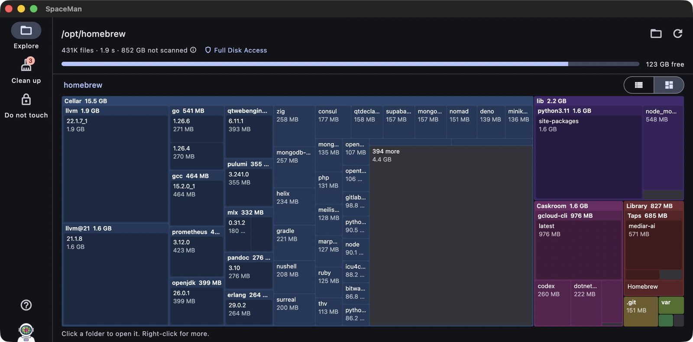
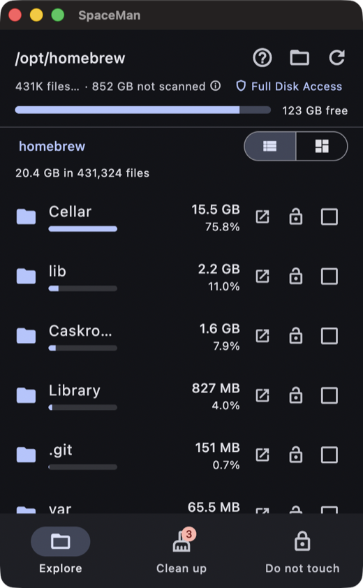

# SpaceMan


Free up disk space, fast. SpaceMan shows where your space goes, suggests what
can safely be removed and lets you mark things as "do not touch".

A Flutter app on top of a Rust core, connected with
[flutter_rust_bridge](https://cjycode.com/flutter_rust_bridge/). macOS comes
first; Windows, Linux, iOS and Android share the same code.

<p>
  
  &nbsp;
  
</p>

## Download

<p>
  <a href="https://github.com/ontola/spaceman/releases/latest/download/SpaceMan-macOS.zip"></a>
  <a href="https://github.com/ontola/spaceman/releases/latest/download/SpaceMan-Windows.zip"></a>
  <a href="https://github.com/ontola/spaceman/releases/latest/download/SpaceMan-Android.apk"></a>
</p>

The builds are not signed yet:

- **macOS**: unzip, move SpaceMan.app to Applications, and the first time
  right-click it and choose *Open*.
- **Windows**: unzip, run `SpaceMan.exe`, and if SmartScreen warns, choose
  *More info*, *Run anyway*.
- **Android**: open the APK on your phone and allow installing from this
  source.

All versions are on the [releases page](https://github.com/ontola/spaceman/releases).
The newest build of `main` is the [development build](https://github.com/ontola/spaceman/releases/tag/dev).

## Features

- **Explore**: drill down through folders, largest first, as a treemap or
  as a list with sizes and shares of the parent folder. Results appear
  while the scan is still running. Go back up with Esc, a swipe, scrolling
  up or pinching out in the treemap, or pulling the list down.
- **Clean up**: suggestions for caches, build output (`node_modules`, Rust
  `target`, Flutter `build`, Xcode DerivedData, ...), logs, the Trash, old
  downloads and files of a gigabyte or more, grouped by kind. Nothing is
  ticked for you.
- **Do not touch**: protect any file or folder. Protected items, and
  everything inside them, are never suggested and cannot be removed.
- Removing moves items to the Trash, so it can be undone. Folders that apps
  expect to exist (caches, Downloads) are emptied instead of removed.

## Fast, and cached

- The scanner walks the disk in parallel (rayon work stealing), measures real
  on-disk size (`st_blocks`), never follows symlinks, stays on one filesystem
  and counts hard links once. A warm scan of a 237k file tree takes ~0.2 s,
  about 5x faster than `du`.
- Scan results are cached on disk (bincode + lz4). On startup the last scan is
  shown instantly, then refreshed in the background.
- Rescans reuse the cached listing of every directory whose modification time
  did not change, so only changed folders are read again: ~30 ms for that
  same tree. Use *Full rescan* (right-click the refresh button) to also pick
  up files that changed size in place.
- Files under 1 MB are folded into one "N smaller files" entry per folder, so
  memory stays small even for millions of files. The tree stays in Rust; the
  UI only asks for the rows it shows.

## Alternative to

- [dua](https://github.com/Byron/dua-cli) / [dust](https://github.com/bootandy/dust):
  fast Rust disk usage tools for the terminal. SpaceMan has the same kind of
  parallel Rust scanner, but in a GUI that also runs on mobile.
- [WinDirStat](https://windirstat.net): the classic Windows treemap.
  SpaceMan adds cleanup suggestions, a scan cache and macOS/Android support.
- [WizTree](https://diskanalyzer.com): very fast on Windows by reading the
  NTFS master file table directly. Windows only and closed source.
- [Disk Inventory X](https://www.derlien.com): treemap for macOS, no longer
  actively developed.
- [DaisyDisk](https://daisydiskapp.com): polished paid sunburst for macOS.
- [GrandPerspective](https://grandperspectiv.sourceforge.net) and
  [OmniDiskSweeper](https://www.omnigroup.com/more): free macOS disk viewers.
- [CleanMyMac](https://macpaw.com/cleanmymac): paid macOS cleaner with cleanup
  suggestions, macOS only.
- [TreeSize](https://www.jam-software.com/treesize_free) and
  [SpaceSniffer](https://www.uderzo.it/main_products/space_sniffer/): Windows
  disk viewers.
- [ncdu](https://dev.yorhel.nl/ncdu) / [gdu](https://github.com/dundee/gdu):
  interactive terminal disk usage tools.
- [QDirStat](https://github.com/shundhammer/qdirstat),
  [Filelight](https://apps.kde.org/filelight/) and
  [Baobab](https://apps.gnome.org/Baobab/): Linux desktop disk viewers.
- [Files by Google](https://files.google.com): cleanup suggestions on
  Android, Android only.

## Layout

```
rust/src/core/      platform-independent core (no Flutter)
  scan.rs           parallel, incremental scanner
  tree.rs           flat arena tree of the scan
  cache.rs          on-disk scan cache
  rules.rs          cleanup suggestions, per platform
  protect.rs        "do not touch" list
  live.rs           coarse view of a scan while it runs
  privacy.rs        macOS folders that need Full Disk Access
rust/src/api/       the API exposed to Dart (flutter_rust_bridge)
lib/                Flutter UI
  app_model.dart    app state, forwards actions to the core
  screens/          Explore, Clean up, Do not touch, Apps (Android)
  widgets/          header, selection bar, row controls, treemap
lib/src/rust/       generated bindings, do not edit
test/               Flutter tests, against a fake core (test/support)
rust_builder/       cargokit glue that builds the Rust crate per platform
```

## Development

Requirements: Flutter (stable), Rust (stable). On macOS also Xcode; on
Windows Visual Studio with the "Desktop development with C++" workload.

```sh
flutter run -d macos           # builds the Rust crate automatically
flutter test                   # UI and app state, no Rust needed
cd rust && cargo test          # core tests
cargo run --release --example scan -- ~ /tmp/scan.bin   # benchmark
```

After changing anything in `rust/src/api/`, regenerate the bindings:

```sh
cargo install flutter_rust_bridge_codegen cargo-expand
flutter_rust_bridge_codegen generate
```

The logo is drawn in code (`lib/widgets/logo.dart`) from the colours in
`lib/palette.dart`, which the theme and the treemap use too. After changing
either, regenerate the app icons, Android adaptive icon and splash screens for macOS,
iOS, Windows and Android:

```sh
flutter test tool/generate_icons.dart
```

### macOS notes

The app is not sandboxed, because it needs to read the whole disk and use the
Trash. That rules out the Mac App Store; distribute it signed and notarized
instead. To scan protected locations (Mail, Messages, other users' folders),
grant SpaceMan *Full Disk Access* in System Settings > Privacy & Security.

### Windows notes

`flutter run -d windows` or `flutter build windows --release`; the app is
`build\windows\x64\runner\Release\SpaceMan.exe` with the DLLs and `data`
folder next to it. No permissions are needed. Removed items go to the Recycle
Bin. Files in OneDrive that are only in the cloud count as taking no space.

CI publishes unsigned macOS and Windows zips as the `dev` prerelease.

### Android notes

SpaceMan scans shared storage (`/storage/emulated/0`) and needs *All files
access* (`MANAGE_EXTERNAL_STORAGE`) for that; the app asks on first start.
Android has no trash for apps, so removing deletes permanently. Other apps'
private data (`Android/data`) stays out of reach, even with that permission.
Google Play only allows this permission for file managers and the like, so
for now the APK is installed directly.

```sh
flutter run -d <device>                    # needs the Android SDK and NDK
flutter build apk --target-platform android-arm64
```

CI publishes `SpaceMan-Android.apk` with every development build. It is
signed with CI's throwaway debug key, so uninstall the previous build before
installing a new one.

## Releasing

Set `version` in `pubspec.yaml` (and `rust/Cargo.toml`), merge to `main`, then
push a matching tag:

```sh
git tag v0.1.0 && git push origin v0.1.0
```

CI builds macOS, Windows and Android and publishes them as release `v0.1.0`,
which the download buttons above then point at.

## Ideas

- FSEvents (macOS) / USN journal (Windows) for instant, exact incremental scans
- Duplicate file finder
- Treemap / sunburst view
- Docker, Homebrew and simulator cleanup through their own CLIs
